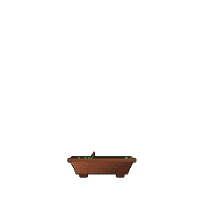

<!-- 1. Ana Başlık -->

<!-- 2. Alt Başlık -->

  

<!-- 3. Git Bonsai (Dinamik Büyüyen Ağaç) -->

 

   

<!-- 4. Yetenekler Başlığı -->

 

<!-- 5. Teknoloji İkonları -->

   

<!-- 6. Hareketli Gökkuşağı Çizgisi -->

  

<!-- 7. İstatistikler Başlığı -->

 

<!-- 8. İstatistikler ve Diller -->

  

   

<!-- 9. Yılan Animasyonu (Snake) -->

 

